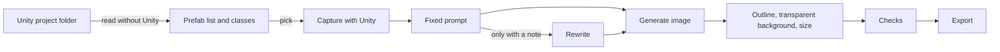

# Icon Studio (unity-icon-studio)

[한국어](README.md)

A Windows desktop app that captures prefabs of a Unity project with Unity, has an image model redraw
the capture in a casual game icon style, and adds a thick outline and a transparent background in code.

> Work in progress. For now there is the app frame and the project and prefab list.

## What it does



## Requirements

- Windows 10/11
- A Unity 6 project (prefabs serialized as text)
- Images: Codex CLI signed in with ChatGPT. Rewriting (optional): Claude Code CLI
- To build from source: Node.js 20 or later, Rust, Visual Studio C++ Build Tools

## Build from source

```powershell
npm ci
npm test
cargo test --workspace
npm run tauri build -- --no-bundle
```

`start.bat` builds when the source is newer, installs to `%LOCALAPPDATA%\UnityIconStudio` and starts the app.

The tool folder is `%USERPROFILE%\.unity-icon-studio`; the environment variable `UNITY_ICON_STUDIO_HOME` replaces it.

## Command line

`cargo run -p uis-cli -- <command> --json` (the program is `uis`). It uses the same tool folder as the app.

## What it never does

- End Unity by force, or open or close an open editor.
- Write icons into the project, commit, change `Packages/manifest.json` or switch the platform.

## Sources and license

MIT License ([LICENSE](LICENSE)). The window frame's sources and the libraries are listed in
[THIRD_PARTY_NOTICES.md](THIRD_PARTY_NOTICES.md).
Unity is a trademark of Unity Technologies. This project is not affiliated with Unity, OpenAI or Anthropic.
