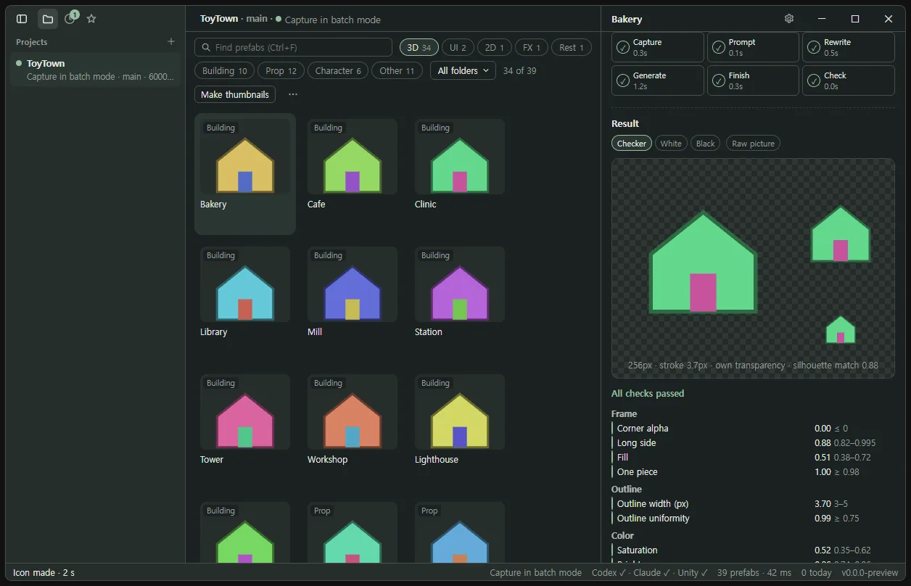
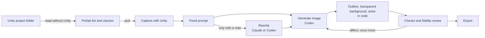

# Icon Studio (unity-icon-studio)

[한국어](README.md)

A Windows desktop app that captures prefabs of a Unity project with Unity, has an image model redraw
the capture in a casual game icon style, and adds a thick outline and a transparent background in
code. The image model and the rewriting model are **the CLIs installed on your PC and signed in with
your own account** (Codex, and optionally Claude Code); the app runs them as they are.



> Screenshots come from the browser preview (`?sample=1`) with made-up data; the pictures are shapes drawn in code.

## What it does



1. **Projects and prefabs:** add a project folder; the app reads its `.prefab` files without Unity, sorts them into 3D, UI, 2D and FX, and guesses a kind (building, prop, character, other).
2. **Capture:** Unity captures the picked prefabs at 1024 px on a transparent background, with a fixed camera and light per kind.
3. **Fixed prompt:** the code assembles the sentence blocks of the style pack; the capture's camera values go into the text.
4. **Note and rewrite:** an empty note calls no LLM and sends the fixed prompt as it is. With a note, the rewriting model may only replace or add unlocked sentences; the code checks that every locked sentence is byte for byte the same and shows a before/after.
5. **Generate:** Codex's built-in image tool repaints the capture, in a fresh temporary session each time. The default is **keep the original**: every part keeps its count, place, relative size and pattern, and nothing the capture lacks (sparkles, hearts …) is added. "Stylize" allows exaggeration, simplification, small charms and the style references.
6. **Finish:** alpha, layout on the canvas, the outline, and downscaling to 256 px (512 px optional). The 1024 px picture is kept.
7. **Check and export:** pixel checks (fill, outline width …) and, when keeping the original, fidelity checks against the capture (proportions, new colors, pieces outside the silhouette, color change) and an LLM fidelity review (added, resized, missing parts). A picture that differs is made once more with a sentence naming the parts to fix; if it still differs it is marked and a person decides. The picked candidate goes to a folder outside the project.

## Requirements

| What | Needed | Notes |
|---|---|---|
| Windows 10 / 11 | yes | x64 |
| A Unity 6 project | yes | Prefabs serialized as text (YAML). The exact Unity editor version of the project must be installed (found through Unity Hub's install list) |
| Codex CLI or the Codex desktop app | yes (pictures) | Installed by you and signed in with `codex login`. With only the desktop app, the app copies its Codex into the tool folder (about 0.5 GB, after you agree in a banner) |
| Claude Code CLI | optional (rewrite) | Installed and signed in by you. Without it, Codex rewrites too. Can be turned off in the settings |
| `com.unity.pipeline` package | optional | With it in the project, captures run **in the open editor**. Without it, close the editor and captures run in batch mode |

The app does not bundle any of these programs; it finds and runs the ones on your PC.

## Install and run

### Release installer

Download `Icon-Studio_<version>_x64-setup.exe` from the release and run it (per-user install, no administrator rights).

- **It is not code-signed.** If Windows SmartScreen shows 「Windows protected your PC」, choose **More info → Run anyway**.
  Smart App Control on Windows 11 may block unsigned apps; build from source then.
- Check the download against `SHA256SUMS.txt` of the release:
  `Get-FileHash -Algorithm SHA256 .\Icon-Studio_<version>_x64-setup.exe`

### Build from source

Needs Node.js 20+, Rust (stable), Visual Studio C++ Build Tools and WebView2 (built into Windows 11).

```powershell
npm ci
npm test
cargo test --workspace
npm run tauri build -- --no-bundle   # target\release\unity-icon-studio.exe
```

`start.bat` (run it from Explorer) builds when the source is newer, installs into `%LOCALAPPDATA%\UnityIconStudio` and starts the app.
`scripts\build-release.ps1` makes the installer and `SHA256SUMS.txt`, and checks that the builder's user folder is not left inside the binaries.

## How to use it

1. **Add a project:** `+` in 「Projects」 → pick a folder (Ctrl+O), type a path, or take one from Unity Hub's list. Dropping a folder on the window works too.
2. **Pick prefabs:** narrow the grid with find (Ctrl+F), the class chips (「3D only」 by default), kind chips and folders. Ctrl/Shift+click picks several.
   「Make thumbnails」 captures the visible 3D prefabs in one request as 128 px thumbnails (it asks first, with an estimate).
3. **Check the capture (optional):** 「Capture」 (Ctrl+R) shows the capture alone. 「Make icon」 captures first when there is no picture yet.
4. **Note (optional):** leave it empty to send the fixed prompt as it is. With a note, 「Preview rewrite」 (Ctrl+Shift+Enter) shows the changed and added sentences and what was left out, without a picture.
5. **Make icon** (Ctrl+Enter): capture → prompt → rewrite → generate → finish → check, each step with its time. Esc stops it (a capture finishes its request first).
6. **Result:** candidates with passed checks and 「Best」, the icon at 256, 128 and 64 px, the 「Raw picture」, the checks table. 「Finish again」 changes only the outline or background (no new picture).
7. **Export** (Ctrl+E): file name, sizes (256, 512, 1024) and folder. Folders inside a Unity project are refused.
8. **Runs:** the 「Runs」 tab (Ctrl+2) opens earlier results: export again, finish again, or run again with the same settings.

With several prefabs picked, 「Make N icons」 captures them in one request and makes the pictures one by one. A usage limit stops the items still waiting.
Afterwards 「Export all that passed」 appears.

### Layout

| Area | Contents |
|---|---|
| Side tabs | Projects (capture dot: batch, open editor, blocked) · Runs · Styles |
| Middle | Find, class and kind chips, folder, make thumbnails, the prefab grid |
| Right | Capture preview (checker, white, black), kind, note, make options (candidates, outline, background), steps, result, checks, export |
| Status bar | Project path · capture mode · Codex, Claude, Unity readiness · progress · pictures made today · version |

### Shortcuts

| Keys | Action |
|---|---|
| Ctrl+O | Add folder |
| Ctrl+F | Find |
| F5 / Shift+F5 | Read the prefabs again / without the cache |
| Ctrl+R | Capture |
| Ctrl+Enter | Make icon |
| Ctrl+Shift+Enter | Preview rewrite |
| Ctrl+E | Export |
| Esc | Close a menu or dialog; while making, ask to stop |
| Ctrl+1 / 2 / 3 | Projects / Runs / Styles |
| Ctrl+B / Ctrl+\\ | Fold the side tabs / the right column |
| Ctrl+, | Settings |
| Ctrl+Shift+D | Light / dark |
| B | Preview background (while the preview has the focus) |

## Style packs

A style pack is a JSON file with the camera per kind, the prompt's sentence blocks, the outline color and width, the canvas fill, the check ranges and style reference pictures.

- The **default pack** ships with the app (「Casual thick outline」, no game names).
- **Local packs** live in `%USERPROFILE%\.unity-icon-studio\packs\<id>\pack.json` (+ `refs\*.png`), outside any repository, so game-specific rules and reference pictures can go there.
  `"extends": "default"` lays them over the default pack. Pick a pack per project in the 「Styles」 tab.

```json
{
  "schema": "unity-icon-studio.pack/1",
  "id": "mygame",
  "name": { "en": "My game" },
  "extends": "default",
  "kindRules": [
    { "match": "**/Buildings/*.prefab", "kind": "building" },
    { "match": "**/Props/Hats/*.prefab", "kind": "prop", "rotation": [270, 0, 0] }
  ],
  "kinds": { "building": { "capture": { "front": "-z" } } },
  "styleRefs": ["refs/icon_a.png", "refs/icon_b.png"],
  "bannedTerms": ["Product Name"]
}
```

- Prompt sentences are marked locked or open. **Locked sentences** (camera, outline, background, the don'ts) go byte for byte even with a note; a note can only change open sentences (color, surface, mood, simplification) or add sentences.
- A reference picture whose file name holds the target prefab's name is left out (so an icon is never copied from itself).
- Words in `bannedTerms`, and notes that would add a background, text or a logo, are not applied; the screen lists them with the reason.
- Strict and stylized sentences, additions asked for in a note, and the fidelity checks, review and retry are described in [Writing style packs](docs/style-packs.en.md).

## Two ways to capture, and what stays in the project

| Way | When | Left in the project |
|---|---|---|
| **Open editor** | The project is open and has `com.unity.pipeline` | Nothing. The capture script and job file stay in the tool folder and run through the `unity` CLI's `script run` |
| **Batch mode** | The project is closed | Only while it runs: an untracked folder `Assets/__UnityIconStudioCapture/Editor/` (one script + an asmdef), removed afterwards. Tracked files Unity rewrote (`*.mat`, `*.asset`, `*.meta`, `ProjectSettings/*` that were clean at the start) are saved as a `git diff` patch in the tool folder and put back |

- When the project is open but cannot be captured in the editor (no package, still starting), the app does not capture and says why. It never **opens or closes** your editor.
- Unity is **never ended by force**. When a batch capture runs past its limit (30 min by default) the app only stops waiting; once Unity ends, the next start cleans up (a banner, or `uis recover`).
- Both ways use the same capture script and the same job file.
- **Before/after capture hooks:** command arrays in `capture.hooks.beforeCapture` / `afterCapture` run around each capture, with `{mode}` `{projectPath}` `{projectName}` `{runId}` `{stateDir}` `{owner}`. Exit code 0 goes on, 4 refuses (its last output line is shown), anything else is an error. Use them to take and release a lock when other tools share the editor.

## Settings

The settings file is `%USERPROFILE%\.unity-icon-studio\settings.json` (the environment variable `UNITY_ICON_STUDIO_HOME` moves the tool folder). Most of it is in the settings popup (Ctrl+,).

| Key | Default | Meaning |
|---|---|---|
| `language`, `theme` | `auto`, `system` | Screen language (Korean, English), theme |
| `workDir` | `work` in the tool folder | Job folders (capture, prompt, raw picture, finish, checks) |
| `exportDir`, `exportName`, `exportSizes` | none, `icon_{prefab}`, `[256]` | Export folder, name rule, sizes |
| `capture.mode` | `auto` | `auto` / `attach` (open editor only) / `batch` (batch only) |
| `capture.editors` | `{}` | Unity version → `Unity.exe` (when it is not found) |
| `capture.batchTimeoutMin`, `capture.restoreTrackedFiles` | `30`, `true` | Batch wait, putting rewritten tracked files back |
| `codex.path` | automatic | Codex program (setting → copy in the tool folder → PATH → desktop app) |
| `codex.ignoreUserConfig`, `codex.trimContext` | `true`, `true` | Keep your Codex config file and the apps, plugins and skills notes out of the picture session |
| `codex.cleanGeneratedImages` | `true` | Remove the pictures this run left in `CODEX_HOME\generated_images` after copying them |
| `claude.enabled`, `claude.model`, `claude.effort` | `true`, `sonnet`, `low` | Use Claude, and its model for rewrites |
| `llm.rewriter` | `claude` | Rewriting CLI (falls back to Codex) |
| `generate.candidates`, `generate.outline`, `generate.background` | `1`, `code`, `transparent` | Candidates, outline (code, model, none), background (transparent, flat) |
| `generate.styleRefs` | `true` | Send the pack's reference pictures (stylized only) |
| `generate.fidelity`, `generate.fidelityRetries` | `strict`, `1` | Keep the original or stylize; tries with corrections when a picture differs (0 to 2) |
| `llm.fidelityReview` | `codex` | Fidelity review of kept-original pictures (`off`, `claude`, `codex`, `both`) |

## Command line `uis`

The same tool folder and the same functions as the app. `--json` prints JSON.

```powershell
cargo run -q -p uis-cli -- run --project C:\Projects\MyGame --prefab Assets/Props/Crate.prefab --note "snow on the roof" --to C:\Icons
cargo run -q -p uis-cli -- help
```

Commands: `scan`, `probe`, `capture`, `recover`, `readiness`, `prompt`, `rewrite`, `generate`, `post`, `check`, `fidelity`, `board`, `run`, `export`, `jobs`, `packs`, `hub`.
`run` takes `--fidelity strict|stylized`, `--review off|claude|codex|both`, `--retries N` and `--capture <png> --kind <kind>` (that picture instead of a capture); `fidelity <capture> <generated> [--review both]` only measures and reviews.

## Accounts and terms

The app **runs the Codex CLI and the Claude Code CLI that you installed on your PC and signed in to with your own account**, as they are.
It does not read, copy or store any credentials (the sign-in stays in each CLI's own folder). It removes API key environment variables from
the child processes so a subscription sign-in is never quietly switched to API billing. Every picture counts against your account's usage limit.

You are responsible for reading and following the terms and usage policies of each service (OpenAI, Anthropic). To not use Claude, turn off
「Use Claude」 in the settings; Codex then does the rewrites as well, and everything works with Codex alone.

## Known points

- **Render state of open-editor captures:** if a project changes rendering from editor code (for example code that swaps materials after the editor starts, on a delayed call),
  an open-editor capture follows that editor's current state and can differ from a batch capture, which always captures right after start-up. If you see a difference, set the capture mode to 「Batch」 or reopen the editor.
- **Your global Codex instructions:** your global `~\.codex\AGENTS.md` cannot be turned off and is loaded into the picture session too. It can change the language of Codex's progress messages; it did not affect the pictures or how they are collected.
- **Usage limits:** the CLIs do not tell how much is left, so the app does not show it; the status bar shows how many pictures it made today.
- **Codex image tool:** runs that end without a picture (exit code 0) and runs that stall with reference pictures have been reported. The app collects the picture in three ways, has a time limit (300 s by default) and an 「Again without references」 button. It never retries by itself (that would spend the limit).
- Results differ from run to run. Each job folder keeps the CLI versions, model, prompt and template version.

## Tested with

| Item | Checked |
|---|---|
| OS | Windows 10 22H2 (x64) |
| Unity | 6000.6.0f1, URP, Direct3D 12 — open-editor and batch captures |
| CLIs | Codex CLI 0.171 alpha (copied from the desktop app), Claude Code CLI, `unity` CLI 1.0.0-beta.14 |
| End to end | With stand-in Unity, Codex and Claude (`uis-stub`): capture → rewrite → generate → finish → check → export, and failures (`scripts\e2e-stub.ps1`) |

Not checked: HDRP and the built-in render pipeline, Unity 2022.3 and older, Direct3D 11, binary-serialized prefabs, Windows 11 Smart App Control, macOS, Linux.

## What it does not do

- End Unity by force, or open or close your editor.
- Write icons into a project, commit, change `Packages/manifest.json` or switch the build platform.
- Handle credentials. There is no auto-update and no code signing.

## Development

| Command | What |
|---|---|
| `npm test` | Screen unit tests (vitest + jsdom) |
| `npm run build` | Text table check (`scripts\check-i18n.mjs`) + type check + screen build |
| `cargo test --workspace` | Core, command line and stand-in CLI tests |
| `scripts\e2e-stub.ps1` | `uis run` end to end with stand-in programs, three failures, rewrite and review on both paths (Claude, Codex) and the fallback when Claude is missing, the strict fidelity review on both paths and the retry |
| `scripts\drive-window.mjs` | For end-to-end checks in the real window: presses buttons, reads the state and takes screenshots through the WebView2 remote debugging port, which is open only in the app it `launch`es. `scripts\window-e2e.json` is the whole flow against the stand-ins |
| `npm run dev` → `http://localhost:1441/?sample=1` | Browser preview (made-up data). `?lang=en`, `?theme=dark`, `?pick=1`, `?fail=limit` |

**Test rule:** for features where the CLI can be picked (rewrite, review), test and check both paths, Claude and Codex, and record both results.

```powershell
powershell -NoProfile -ExecutionPolicy Bypass -File scripts\e2e-stub.ps1 -BedOnly -Bed $env:TEMP\uis-bed
node scripts\drive-window.mjs launch target\release\unity-icon-studio.exe --home $env:TEMP\uis-bed\home --env CODEX_HOME=$env:TEMP\uis-bed\codex-home
node scripts\drive-window.mjs run scripts\window-e2e.json --var GAME=$env:TEMP\uis-bed\Game --var BIN=$env:TEMP\uis-bed\bin --var SHOTS=$env:TEMP
```

## Sources and license

MIT License ([LICENSE](LICENSE)). The window frame's origin and the libraries are in [THIRD_PARTY_NOTICES.md](THIRD_PARTY_NOTICES.md).

Unity is a trademark of Unity Technologies. This project is not affiliated with Unity, OpenAI or Anthropic.
