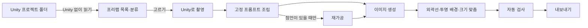

# 아이콘 스튜디오 (unity-icon-studio)

[English](README.en.md)

Unity 프로젝트의 프리팹을 Unity로 찍고, 그 촬영본을 이미지 모델이 캐주얼 게임 아이콘 화풍으로 다시 그리게 한 뒤,
두꺼운 외곽선과 투명 배경을 코드로 입히는 Windows 데스크톱 앱입니다.

> 만드는 중입니다. 지금은 앱 틀과 프로젝트·프리팹 목록까지 있습니다.

## 하는 일



## 준비물

- Windows 10/11
- Unity 6 프로젝트(프리팹이 텍스트로 직렬화된 프로젝트)
- 그림 생성: Codex CLI와 ChatGPT 로그인. 재가공(선택): Claude Code CLI
- 소스로 빌드할 때: Node.js 20 이상, Rust, Visual Studio C++ Build Tools

## 소스로 빌드하기

```powershell
npm ci
npm test
cargo test --workspace
npm run tauri build -- --no-bundle
```

`start.bat`은 소스가 새로우면 빌드한 뒤 `%LOCALAPPDATA%\UnityIconStudio`에 설치하고 실행합니다.

도구 폴더는 `%USERPROFILE%\.unity-icon-studio`입니다. 환경 변수 `UNITY_ICON_STUDIO_HOME`으로 바꿀 수 있습니다.

## 명령줄

`cargo run -p uis-cli -- <명령> --json` (실행 파일 이름 `uis`). 앱과 같은 도구 폴더를 씁니다.

## 하지 않는 것

- Unity를 강제로 끝내지 않습니다. 열린 에디터를 열거나 닫지 않습니다.
- 프로젝트에 아이콘을 쓰거나, 커밋하거나, `Packages/manifest.json`을 바꾸거나, 플랫폼을 바꾸지 않습니다.

## 출처와 라이선스

MIT 라이선스입니다([LICENSE](LICENSE)). 창 틀의 출처와 라이브러리는 [THIRD_PARTY_NOTICES.md](THIRD_PARTY_NOTICES.md)에 있습니다.
Unity is a trademark of Unity Technologies. This project is not affiliated with Unity, OpenAI or Anthropic.
