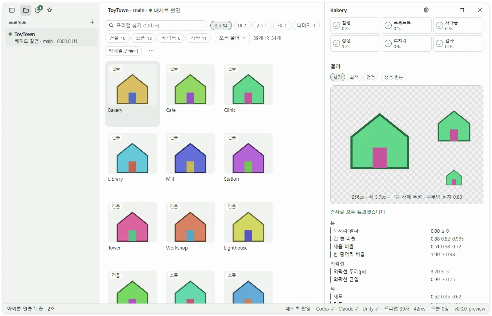
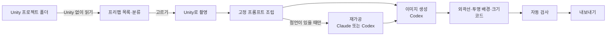
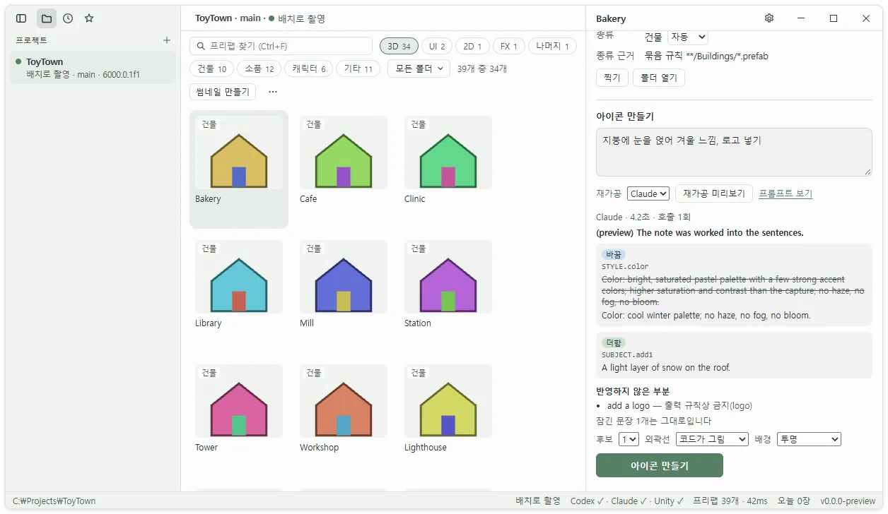

# 아이콘 스튜디오 (unity-icon-studio)

[English](README.en.md)

Unity 프로젝트의 프리팹을 Unity로 찍고, 그 촬영본을 이미지 모델이 캐주얼 게임 아이콘 화풍으로 다시 그리게 한 뒤,
두꺼운 외곽선과 투명 배경을 코드로 입히는 Windows 데스크톱 앱입니다. 이미지 모델과 재가공 모델은 **사용자 PC에 설치되어
있고 사용자 본인 계정으로 로그인된 CLI**(Codex, 선택으로 Claude Code)를 그대로 실행합니다.



> 스크린샷은 브라우저 미리보기(`?sample=1`)의 가짜 데이터입니다. 그림은 코드로 그린 도형입니다.

## 하는 일



1. **프로젝트·프리팹 목록:** 프로젝트 폴더를 추가하면 Unity 없이 `.prefab`을 읽어 3D·UI·2D·FX로 나누고, 종류(건물·소품·캐릭터·기타)를 추정합니다.
2. **촬영:** 고른 프리팹을 Unity가 투명 배경 1024px로 찍습니다. 종류마다 정해진 구도(카메라 각도·조명)를 씁니다.
3. **고정 프롬프트:** 스타일 묶음의 문장 블록을 코드가 조립합니다. 촬영 구도 값도 문장에 들어갑니다.
4. **첨언과 재가공:** 첨언이 비어 있으면 LLM을 부르지 않고 고정 프롬프트를 그대로 보냅니다. 첨언이 있으면 재가공 모델이 잠기지 않은 문장만 바꾸거나 더하고, 코드가 잠긴 문장이 바이트 그대로인지 확인한 뒤 전후 비교를 보여 줍니다.
5. **생성:** Codex의 내장 이미지 도구가 촬영본(과 스타일 참고 그림)을 받아 그립니다. 매번 빈 임시 세션입니다.
6. **후처리:** 알파를 확보하고, 캔버스에 배치하고, 외곽선을 그리고, 256px(선택 512px)로 줄입니다. 1024px 원본도 남깁니다.
7. **검사·내보내기:** 채움 비율·외곽선 두께·채도 같은 픽셀 검사를 하고, 사람이 고른 후보를 프로젝트 밖 폴더로 내보냅니다.

## 준비물

| 무엇 | 필요 | 메모 |
|---|---|---|
| Windows 10 / 11 | 필수 | x64 |
| Unity 6 프로젝트 | 필수 | 프리팹이 텍스트(YAML)로 직렬화된 프로젝트. 프로젝트 버전과 정확히 같은 Unity 에디터가 설치되어 있어야 합니다(Unity Hub 설치 목록에서 찾습니다) |
| Codex CLI 또는 Codex 데스크톱 앱 | 필수(그림 생성) | 사용자 본인이 설치하고 `codex login`으로 로그인합니다. 데스크톱 앱만 있으면 앱 안의 Codex를 도구 폴더로 복사해 씁니다(약 0.5GB, 화면 배너에서 동의 후) |
| Claude Code CLI | 선택(재가공) | 사용자 본인이 설치하고 로그인합니다. 없으면 재가공도 Codex가 합니다. 설정에서 끌 수 있습니다 |
| `com.unity.pipeline` 패키지 | 선택 | 프로젝트에 있으면 **열린 에디터**에서 바로 찍을 수 있습니다. 없으면 에디터를 닫은 상태에서 배치모드로 찍습니다 |

도구는 이 프로그램들을 번들하지 않습니다. 사용자 PC에 있는 것을 찾아 실행합니다.

## 설치와 실행

### 릴리스 설치기

릴리스의 `Icon-Studio_<버전>_x64-setup.exe`를 받아 실행합니다(현재 사용자 설치, 관리자 권한 불필요).

- **코드 서명이 없습니다.** Windows SmartScreen이 「Windows의 PC 보호」를 띄우면 **추가 정보 → 실행**을 누릅니다.
  Windows 11의 스마트 앱 컨트롤이 켜져 있으면 서명 없는 앱이 막힐 수 있습니다. 그때는 아래처럼 소스로 빌드해 쓰세요.
- 받은 파일은 릴리스의 `SHA256SUMS.txt`와 비교해 확인할 수 있습니다:
  `Get-FileHash -Algorithm SHA256 .\Icon-Studio_<버전>_x64-setup.exe`

### 소스로 빌드

필요한 것: Node.js 20 이상, Rust(stable), Visual Studio C++ Build Tools, WebView2(Windows 11에는 기본으로 있음).

```powershell
npm ci
npm test
cargo test --workspace
npm run tauri build -- --no-bundle   # target\release\unity-icon-studio.exe
```

`start.bat`을 탐색기에서 실행하면 소스가 바뀌었을 때만 빌드한 뒤 `%LOCALAPPDATA%\UnityIconStudio`에 설치하고 띄웁니다.
설치기는 `scripts\build-release.ps1`이 만듭니다(설치기, `SHA256SUMS.txt`, 빌드한 사람의 사용자 폴더 경로가 실행 파일에 남지 않았는지 검사).

## 쓰는 법

1. **프로젝트 추가:** 왼쪽 「프로젝트」의 `+` → 폴더 고르기(Ctrl+O), 경로 입력, Unity Hub 목록에서 가져오기. 폴더를 창에 끌어 놓아도 됩니다.
2. **프리팹 고르기:** 가운데 목록에서 찾기(Ctrl+F)·분류 칩(기본 「3D만」)·종류 칩·폴더로 좁힙니다. Ctrl·Shift+클릭으로 여러 개를 고릅니다.
   「썸네일 만들기」는 보이는 3D 프리팹을 한 번의 촬영으로 128px 썸네일로 만듭니다(예상 시간을 먼저 묻습니다).
3. **촬영 확인(선택):** 오른쪽 「찍기」(Ctrl+R)로 촬영본만 먼저 볼 수 있습니다. 「아이콘 만들기」는 촬영본이 없으면 먼저 찍습니다.
4. **첨언(선택):** 비워 두면 고정 프롬프트를 그대로 보냅니다. 적으면 「재가공 미리보기」(Ctrl+Shift+Enter)로 바뀐 문장·더한 문장·반영하지 않은 부분을 그림 없이 먼저 볼 수 있습니다.
5. **아이콘 만들기**(Ctrl+Enter): 촬영 → 프롬프트 → 재가공 → 생성 → 후처리 → 검사가 차례로 진행되고 단계마다 시간이 보입니다. Esc로 멈출 수 있습니다(촬영 중이면 이번 묶음이 끝난 뒤 멈춥니다).
6. **결과:** 후보별 검사 통과 수와 「추천」, 최종 256·128·64px, 「생성 원본」, 검사 표가 나옵니다. 외곽선·배경만 바꿔 「후처리 다시」를 할 수 있습니다(그림을 다시 만들지 않음).
7. **내보내기**(Ctrl+E): 파일 이름·크기(256·512·1024)·폴더를 정해 내보냅니다. Unity 프로젝트 안 폴더는 거부합니다.
8. **지난 작업:** 왼쪽 「지난 작업」 탭(Ctrl+2)에서 이전 결과를 다시 열어 다시 내보내거나, 후처리만 다시 하거나, 같은 설정으로 다시 만들 수 있습니다.



여러 개를 고르고 「N개 만들기」를 누르면 촬영은 한 묶음으로, 생성은 하나씩 차례로 합니다. 사용 한도에 걸리면 남은 항목은 보내지 않고 멈춥니다.
끝나면 「통과한 것 모두 내보내기」가 나옵니다.

### 화면 구성

| 영역 | 내용 |
|---|---|
| 왼쪽 탭 | 프로젝트(촬영 방식 점: 배치·열린 에디터·막힘) · 지난 작업 · 스타일 |
| 가운데 | 찾기, 분류·종류 칩, 폴더, 썸네일 만들기, 프리팹 그리드 |
| 오른쪽 | 촬영 미리보기(배경 체커·흰색·검정), 구도·종류, 첨언, 만들기 옵션(후보 수·외곽선·배경), 진행 단계, 결과·검사·내보내기 |
| 상태바 | 프로젝트 경로 · 촬영 방식 · Codex·Claude·Unity 준비 상태 · 진행 · 오늘 만든 그림 수 · 버전 |

### 단축키

| 키 | 동작 |
|---|---|
| Ctrl+O | 폴더 추가 |
| Ctrl+F | 찾기 |
| F5 / Shift+F5 | 프리팹 다시 읽기 / 캐시 없이 |
| Ctrl+R | 찍기 |
| Ctrl+Enter | 아이콘 만들기 |
| Ctrl+Shift+Enter | 재가공 미리보기 |
| Ctrl+E | 내보내기 |
| Esc | 메뉴·대화상자 닫기, 진행 중이면 멈추기 확인 |
| Ctrl+1 / 2 / 3 | 프로젝트 / 지난 작업 / 스타일 |
| Ctrl+B / Ctrl+\\ | 왼쪽 탭 접기 / 오른쪽 열 접기 |
| Ctrl+, | 설정 |
| Ctrl+Shift+D | 라이트·다크 바꾸기 |
| B | 미리보기 배경 바꾸기(미리보기에 초점이 있을 때) |

## 스타일 묶음

스타일 묶음은 종류별 촬영 구도, 프롬프트 문장 블록, 외곽선 색·두께, 캔버스 채움, 검사 범위, 스타일 참고 그림을 담은 JSON입니다.

- **기본 묶음**은 앱에 들어 있습니다(「캐주얼 두꺼운 외곽선」, 게임 이름 없음).
- **로컬 묶음**은 `%USERPROFILE%\.unity-icon-studio\packs\<id>\pack.json`(+ `refs\*.png`)에 둡니다. 저장소 밖이라 게임 전용 규칙·참고 그림을 둬도 됩니다.
  `"extends": "default"`로 기본 묶음을 덮어씁니다. 「스타일」 탭에서 프로젝트마다 묶음을 고릅니다.

```json
{
  "schema": "unity-icon-studio.pack/1",
  "id": "mygame",
  "name": { "ko": "우리 게임", "en": "My game" },
  "extends": "default",
  "kindRules": [
    { "match": "**/Buildings/*.prefab", "kind": "building" },
    { "match": "**/Props/Hats/*.prefab", "kind": "prop", "rotation": [270, 0, 0] }
  ],
  "kinds": { "building": { "capture": { "front": "-z" } } },
  "styleRefs": ["refs/icon_a.png", "refs/icon_b.png"],
  "bannedTerms": ["제품 이름"]
}
```

- 프롬프트 문장에는 잠금 표시가 있습니다. **잠긴 문장**(구도·외곽선·배경·금지 항목 등)은 첨언이 있어도 바이트 그대로 보냅니다. 첨언은 잠기지 않은 문장(색·질감·분위기·단순화 정도)만 바꾸거나 문장을 더합니다.
- 참고 그림 중 파일 이름에 대상 프리팹 이름이 든 것은 자동으로 뺍니다(자기 아이콘을 베끼지 않게).
- `bannedTerms`에 든 낱말과 배경·글자·로고를 더하는 첨언은 반영하지 않고 이유와 함께 보여 줍니다.

## 촬영 방식 두 가지와 프로젝트에 남기는 것

| 방식 | 언제 | 프로젝트에 남는 것 |
|---|---|---|
| **열린 에디터** | 프로젝트가 열려 있고 `com.unity.pipeline`이 있을 때 | 없음. 촬영 스크립트와 작업 파일은 도구 폴더에 두고 `unity` CLI의 `script run`으로 실행합니다 |
| **배치모드** | 프로젝트가 닫혀 있을 때 | 실행하는 동안만 미추적 임시 폴더 `Assets/__UnityIconStudioCapture/Editor/`(스크립트 1개 + asmdef)를 두고, 끝나면 지웁니다. Unity가 다시 쓴 추적 파일(`*.mat`, `*.asset`, `*.meta`, `ProjectSettings/*` 중 시작 때 깨끗했던 것)은 `git diff` 패치로 도구 폴더에 백업한 뒤 되돌립니다 |

- 프로젝트가 열려 있는데 열린 에디터로 찍을 수 없으면(패키지 없음, 시작 중) 찍지 않고 이유를 보여 줍니다. 도구는 일반 에디터를 **열거나 닫지 않습니다.**
- Unity는 **강제로 끝내지 않습니다.** 배치 촬영이 시간 제한(기본 30분)을 넘기면 기다리기만 멈추고, Unity가 끝난 뒤 다음 시작 때 정리합니다(앱 배너 또는 `uis recover`).
- 같은 촬영 스크립트·같은 작업 파일을 두 방식이 함께 씁니다.
- **촬영 전·후 훅:** 설정 `capture.hooks.beforeCapture` / `afterCapture`에 명령 배열을 넣으면 촬영 앞뒤로 실행합니다. 자리표시 `{mode}` `{projectPath}` `{projectName}` `{runId}` `{stateDir}` `{owner}`. 종료 코드 0은 진행, 4는 거부(마지막 출력 줄을 화면에 보임), 그 밖은 오류입니다. 다른 도구와 에디터를 나눠 쓸 때 잠금을 잡고 놓는 데 씁니다.

## 설정

설정 파일은 `%USERPROFILE%\.unity-icon-studio\settings.json`입니다(환경 변수 `UNITY_ICON_STUDIO_HOME`으로 도구 폴더를 바꿀 수 있습니다). 대부분 화면의 설정(Ctrl+,)에서 바꿉니다.

| 키 | 기본값 | 뜻 |
|---|---|---|
| `language`, `theme` | `auto`, `system` | 화면 언어(한국어·영어), 테마 |
| `workDir` | 도구 폴더 `work` | 실행 폴더(촬영본·프롬프트·생성 원본·후처리·검사) |
| `exportDir`, `exportName`, `exportSizes` | 없음, `icon_{prefab}`, `[256]` | 내보내기 폴더·이름 규칙·크기 |
| `capture.mode` | `auto` | `auto` / `attach`(열린 에디터만) / `batch`(배치만) |
| `capture.editors` | `{}` | Unity 버전 → `Unity.exe` 경로(자동으로 못 찾을 때) |
| `capture.batchTimeoutMin`, `capture.restoreTrackedFiles` | `30`, `true` | 배치 대기 시간, 추적 파일 되돌리기 |
| `codex.path` | 자동 | Codex 실행 파일(설정 → 도구 폴더 사본 → PATH → 데스크톱 앱) |
| `codex.ignoreUserConfig`, `codex.trimContext` | `true`, `true` | 사용자 Codex 설정 파일과 앱·플러그인·스킬 안내를 생성 세션에 싣지 않음 |
| `codex.cleanGeneratedImages` | `true` | 이번 실행이 `CODEX_HOME\generated_images`에 만든 그림을 복사한 뒤 지움 |
| `claude.enabled`, `claude.model`, `claude.effort` | `true`, `sonnet`, `low` | Claude 사용 여부와 재가공 모델 |
| `llm.rewriter` | `claude` | 재가공 CLI(없으면 Codex로 바꿈) |
| `generate.candidates`, `generate.outline`, `generate.background` | `1`, `code`, `transparent` | 후보 수, 외곽선(코드·모델·없음), 배경(투명·단색) |
| `generate.styleRefs` | `true` | 묶음의 참고 그림을 함께 보냄 |

## 명령줄 `uis`

앱과 같은 도구 폴더·같은 함수를 씁니다. `--json`이면 JSON을 출력합니다.

```powershell
cargo run -q -p uis-cli -- run --project C:\Projects\MyGame --prefab Assets/Props/Crate.prefab --note "지붕에 눈" --to C:\Icons
cargo run -q -p uis-cli -- help
```

`scan`, `probe`, `capture`, `recover`, `readiness`, `prompt`, `rewrite`, `generate`, `post`, `check`, `board`, `run`, `export`, `jobs`, `packs`, `hub` 명령이 있습니다.

## 계정과 약관

이 도구는 **사용자 PC에 사용자 본인이 설치하고 로그인한 Codex CLI와 Claude Code CLI를 그대로 실행**합니다.
도구는 계정 정보를 읽거나 복사하거나 저장하지 않습니다(로그인은 각 CLI의 설정 폴더에 그대로 있습니다). API 키 환경 변수는 자식 프로세스에서 지워,
구독 로그인이 아닌 API 과금으로 조용히 바뀌지 않게 합니다. 그림 한 장마다 사용자 계정의 사용 한도를 씁니다.

각 서비스(OpenAI, Anthropic)의 이용 약관과 사용 정책을 사용자가 직접 확인하고 지켜야 합니다. Claude를 쓰지 않으려면 설정에서 「Claude 사용」을 끄세요.
그 경우 재가공도 Codex가 하고, 모든 기능이 Codex만으로 동작합니다.

## 알려진 점

- **열린 에디터로 찍을 때의 렌더 상태:** 프로젝트가 에디터에서 렌더 설정을 바꾸는 코드(예: 에디터가 열린 뒤 지연 실행으로 머티리얼을 바꾸는 코드)를 갖고 있으면,
  열린 에디터 촬영 결과가 그 에디터의 현재 상태를 따라 배치 촬영과 달라질 수 있습니다. 배치 촬영은 시작 직후 같은 상태에서 찍습니다. 차이가 보이면 설정의 촬영 방식을 「배치」로 두거나 에디터를 다시 여세요.
- **사용자 전역 Codex 지침:** 사용자의 전역 `~\.codex\AGENTS.md`는 끌 방법이 없어 생성 세션에도 실립니다. 중간 메시지 언어 등이 달라질 수 있지만 그림과 결과 수확에는 영향이 없었습니다.
- **사용 한도:** 남은 한도는 CLI가 알려 주지 않아 표시하지 않습니다. 상태바에는 「오늘 만든 그림 수」만 보입니다.
- **Codex 이미지 도구:** 그림 없이 끝나거나(종료 코드 0), 참고 그림이 있을 때 멈추는 경우가 보고되어 있습니다. 결과 수확을 세 단계로 하고, 시간 제한(기본 300초)과 「참고 그림 없이 다시」를 둡니다. 자동으로 다시 시도하지는 않습니다(한도를 씀).
- 생성 결과는 매번 다릅니다. 실행 폴더에 CLI 버전·모델·프롬프트·템플릿 버전을 남깁니다.

## 검증 범위

| 항목 | 확인한 것 |
|---|---|
| OS | Windows 10 22H2 (x64) |
| Unity | 6000.6.0f1, URP, Direct3D 12 — 열린 에디터·배치 촬영 모두 |
| CLI | Codex CLI 0.171 알파(데스크톱 앱 사본), Claude Code CLI, `unity` CLI 1.0.0-beta.14 |
| 끝단 시험 | 가짜 Unity·Codex·Claude(`uis-stub`)로 촬영 → 재가공 → 생성 → 후처리 → 검사 → 내보내기와 실패 경우(`scripts\e2e-stub.ps1`) |

확인하지 않은 것: HDRP·Built-in 렌더 파이프라인, Unity 2022.3 이하, Direct3D 11, 바이너리 직렬화 프리팹, Windows 11 스마트 앱 컨트롤, macOS·Linux.

## 하지 않는 것

- Unity를 강제로 끝내지 않습니다. 일반 에디터를 열거나 닫지 않습니다.
- 프로젝트에 아이콘을 쓰거나, 커밋하거나, `Packages/manifest.json`을 바꾸거나, 빌드 대상 플랫폼을 바꾸지 않습니다.
- 계정 정보를 다루지 않습니다. 자동 업데이트·코드 서명이 없습니다.

## 개발

| 명령 | 내용 |
|---|---|
| `npm test` | 화면 단위 시험(vitest + jsdom) |
| `npm run build` | 문자열 표 검사(`scripts\check-i18n.mjs`) + 타입 검사 + 화면 빌드 |
| `cargo test --workspace` | 코어·명령줄·가짜 CLI 시험 |
| `scripts\e2e-stub.ps1` | 가짜 프로그램으로 `uis run` 끝단 시험, 실패 경우 3가지, 재가공·검수의 Claude·Codex 두 경로와 Claude 없음 대체 |
| `scripts\drive-window.mjs` | 실제 창 끝단 확인용: WebView2 원격 디버깅 포트로 앱 창의 버튼을 누르고 상태를 읽고 화면을 찍습니다. `launch`로 띄운 그 앱에만 포트가 열립니다. `scripts\window-e2e.json`은 가짜 프로그램으로 처음부터 끝까지 도는 순서입니다 |
| `npm run dev` → `http://localhost:1441/?sample=1` | 브라우저 미리보기(가짜 데이터). `?lang=en`, `?theme=dark`, `?pick=1`, `?fail=limit` |

**시험 규칙:** 재가공·검수처럼 CLI를 고를 수 있는 기능의 시험과 확인은 Claude·Codex 두 경로를 모두 돌리고 결과를 둘 다 적습니다.

```powershell
powershell -NoProfile -ExecutionPolicy Bypass -File scripts\e2e-stub.ps1 -BedOnly -Bed $env:TEMP\uis-bed
node scripts\drive-window.mjs launch target\release\unity-icon-studio.exe --home $env:TEMP\uis-bed\home --env CODEX_HOME=$env:TEMP\uis-bed\codex-home
node scripts\drive-window.mjs run scripts\window-e2e.json --var GAME=$env:TEMP\uis-bed\Game --var BIN=$env:TEMP\uis-bed\bin --var SHOTS=$env:TEMP
```

## 출처와 라이선스

MIT 라이선스입니다([LICENSE](LICENSE)). 창 틀의 출처와 라이브러리는 [THIRD_PARTY_NOTICES.md](THIRD_PARTY_NOTICES.md)에 있습니다.

Unity is a trademark of Unity Technologies. This project is not affiliated with Unity, OpenAI or Anthropic.
